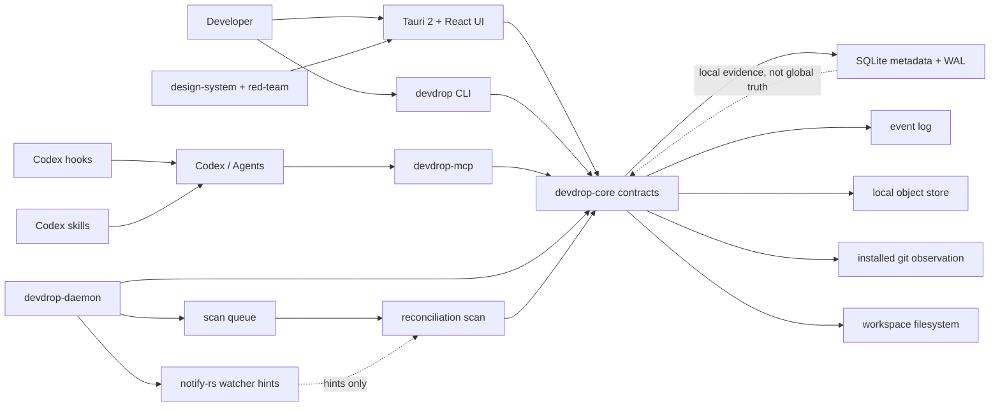
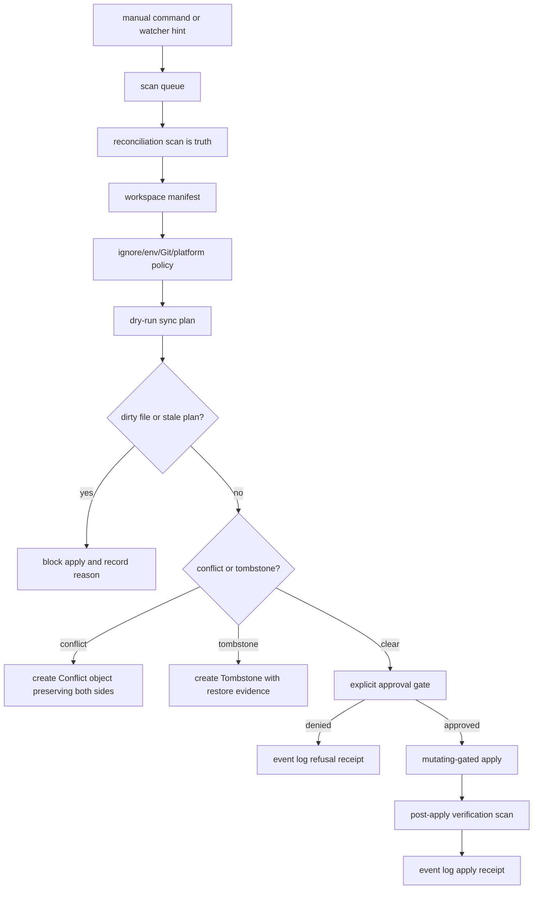
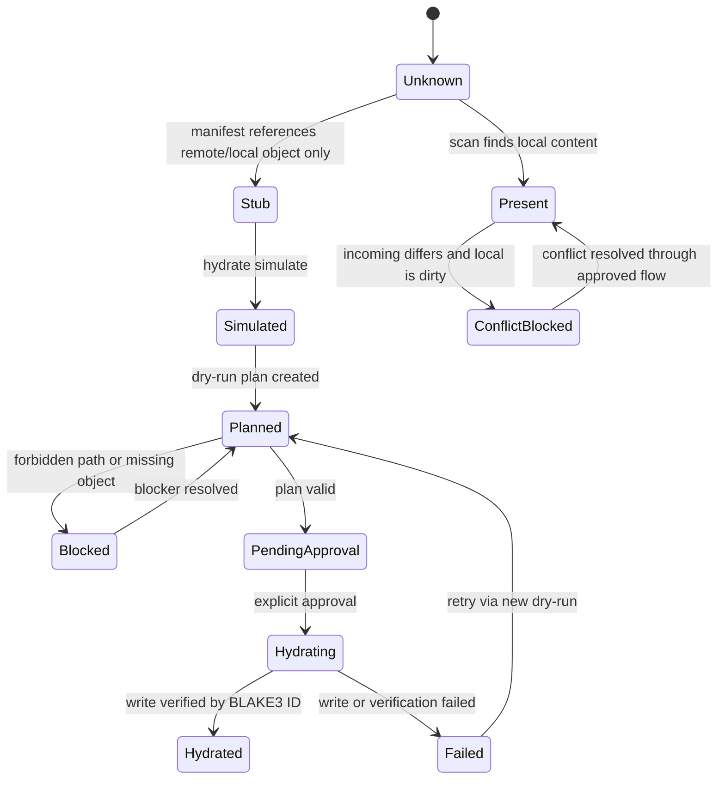
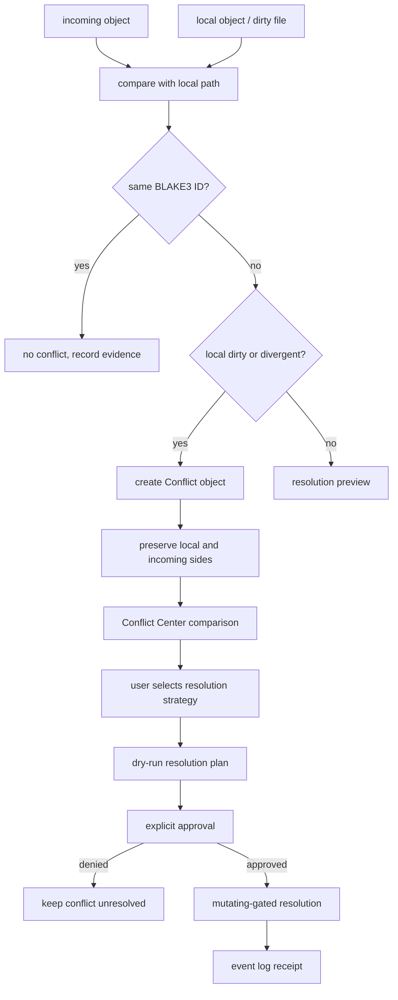
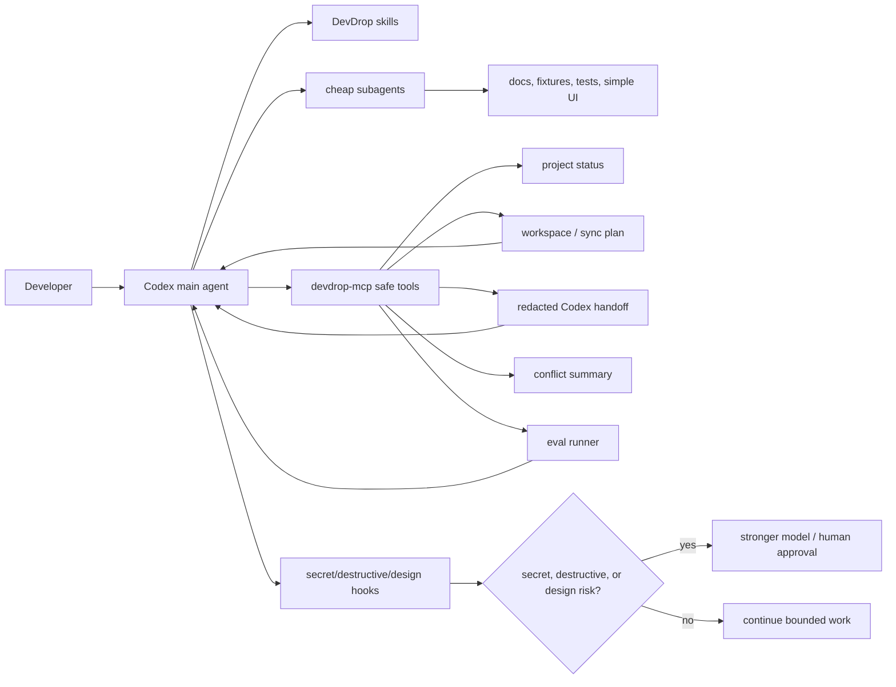

# DevDrop Architecture

DevDrop is a local-first "Dropbox for devs" MVP for keeping developer
workspaces coherent across machines and coding agents. The architecture is full
MVP scope: CLI, Tauri desktop, Rust engine, local metadata, object storage,
sync simulation, hydration, conflicts, tombstones, MCP, hooks, skills, and
red-team loops.

Dangerous behavior is gated. Architecture diagrams describe intended flow, not
permission to delete, overwrite, move, hydrate, or sync user files without
dry-run, explicit approval, rollback notes, event-log coverage, and tests.

## Rust Crates

| Crate | Responsibility | Hard boundary |
| --- | --- | --- |
| `devdrop-core` | Pure models, workspace manifests, object IDs, BLAKE3 hashing, readiness, sync plan types, ignore policy, tombstones, conflict objects, hydration records, machine/env/agent contracts. | No UI. No uncontrolled filesystem mutation. No secret values in serializable models. |
| `devdrop-cli` | CLI commands such as `doctor`, `scan`, `watch`, `status`, `hydrate`, `sync plan`, `sync apply`, conflict commands, machine/env commands, agent commands, and `mcp serve`. | Mutating commands require dry-run plan and explicit approval. |
| `devdrop-daemon` | Watcher integration, scan queue, local API, scheduling, background sync simulation, and future notify-rs/Tokio work. | Watcher events are hints only; reconciliation scan is truth. |
| `devdrop-mcp` | MCP server exposing safe DevDrop tools to Codex and agents: status, plans, handoff, queue preview, conflict summary, eval runner. | Read-only or dry-run by default. Never exposes secret values or raw file contents. |

Tokio belongs only where daemon scheduling, timers, local API, async filesystem
work, or future network/mock remote work needs it. Pure contracts remain sync
and testable.

## Daemon Local API

The daemon MVP is an observer-only local process. It owns scan scheduling,
watcher hint intake, metadata-only reconciliation scans, and local API state.
It does not apply sync, write CAS objects, persist SQLite rows, mutate Git,
hydrate files, resolve conflicts, tombstone-delete files, overwrite files, or
move user files.

Local API rules for this slice:

- Bind addresses must be loopback only. `127.0.0.1:37431` is the default;
  `0.0.0.0`, LAN/public interfaces, IPv6 unspecified `::`, and non-loopback
  IPv6 addresses are refused.
- Localhost is not the long-term security boundary. The API advertises
  `X-DevDrop-Local-Session` as a placeholder safety header for future local
  token/session enforcement.
- Permissive CORS is not enabled.
- Every POST endpoint requires `Content-Type: application/json`.
- Route project IDs are validated against in-memory registered projects. Route
  params never become arbitrary filesystem paths.
- Every applicable response includes a safety envelope with `mutated_files =
  false`, either `dry_run = true` or `read_only = true`, and a redaction
  notice.
- API responses prefer project-relative path evidence. Absolute paths are local
  diagnostics only and must never include secret values or raw file contents.

Implemented local endpoints:

- `GET /health`
- `GET /projects`
- `GET /projects/:id/status`
- `POST /projects/:id/scan`
- `GET /projects/:id/sync-plan`
- `GET /projects/:id/conflicts`
- `GET /projects/:id/hydration`
- `GET /machines`

Daemon state is in-memory until the SQLite metadata layer is implemented.
SQLite WAL/checkpointing remains an architecture contract, not daemon runtime
behavior in this slice.

## Desktop Architecture

- `apps/desktop/src-tauri` is the Tauri 2 shell.
- `apps/desktop/src` is the React/TypeScript UI.
- `apps/desktop/src/design-system` owns the DevDrop visual system: evidence
  rails, machine topology, object plates, approval walls, receipts, conflict
  comparison, and hydration state surfaces.
- The desktop app must not become a generic AI dashboard. No meaningless metric
  cards, vague status pills, fake glass, generic gradients, or default shadcn
  sameness.
- Every page must answer: "Can I safely work here?"

Desktop calls should flow through typed commands and safe contracts. UI should
not infer readiness from partial data; it should show evidence, missing
evidence, and blocked actions.

## Storage Architecture

| Storage concept | Purpose | Notes |
| --- | --- | --- |
| SQLite local metadata | Registry, machines, manifests, event log index, queue state, hydration records, tombstones, conflicts, approvals. | Local evidence, not global truth. Use WAL mode. |
| WAL checkpointing | Keeps local metadata durable and bounded. | Sync apply must define checkpoint timing and crash recovery before mutation. |
| Local object store | Stores eligible content by content ID. | Generated paths and secrets never enter the object store. |
| BLAKE3 content IDs | Fast content identity for eligible bytes. | Hashes identify bytes, not trust or freshness. |
| Event log | Replayable record of scans, plans, approvals, applies, refusals, tombstones, conflicts, and receipts. | Every sync operation must be replayable from it. |
| Tombstones | Deletion intent and restore evidence. | Never silently delete; deletion requires tombstone and restore path. |
| Conflict objects | Preserve local/incoming versions and provenance. | Both sides remain until explicit resolution. |
| Hydration records | Track present, stub, simulated, pending, hydrated, failed, and blocked states. | Stubs never masquerade as real content. |

## Lazy Hydration Simulation MVP

Hydration in the MVP is a sandbox-only simulation proving stub replacement
safety. It is not real lazy hydration across live workspaces.

- `devdrop hydrate --dry-run <path>` previews only. It may inspect metadata and
  exact stub marker text only after the path is inside a recognized test
  sandbox.
- `devdrop hydrate apply <path>` is the only apply-like path, and it is
  CLI-only. Daemon, desktop, watcher, MCP, hooks, and background tasks must not
  call hydration apply.
- Apply may write only inside test sandboxes copied from canonical fixtures.
  Canonical fixtures and fixture object sources are read-only and refused
  directly.
- Sandbox metadata must use the deterministic test-only schema/version and
  fixture registry map. User-created sandbox-looking metadata in live
  workspaces is refused when malformed, incomplete, non-test, or path-like.
- Stub markers use `DEV_DROP_STUB_V1 object_id=<id> hash=blake3:<hex>
  size=<bytes>`. The object id is an identifier, not a path.
- Source bytes are resolved only through deterministic fixture object keys, not
  through CLI arguments, marker text paths, route parameters, UI state, daemon
  requests, MCP tools, hooks, or user-provided object-store locations.
- Apply refuses ignored/generated paths, secret paths, symlink targets, symlink
  parents, dirty-local content, conflict state, stale previews, missing
  objects, and hash mismatches.
- Successful receipts may set `mutated_files = true` only after final target
  hash verification. Blocked and idempotent receipts keep mutation flags false.

## Sync Architecture

- Watcher events are hints.
- Reconciliation scan is truth.
- The daemon scan queue may schedule scans from watcher hints, manual API
  requests, or periodic reconciliation, but only the metadata reconciliation
  scan updates daemon status.
- A dry-run sync plan must exist before apply.
- Apply must refuse stale plans.
- Never overwrite dirty files.
- Never silently delete.
- Conflicts preserve both sides.
- Ignored paths do not upload content.
- Stubs never masquerade as real content.
- Secrets never enter object store, event log, MCP output, CLI output, UI, or
  agent handoff.

Daemon scanner rules:

- Scans are rooted at registered project roots only.
- Watcher hint paths must be contained inside a registered root before they can
  enqueue a scan.
- Generated/default ignored paths such as `node_modules`, `.next`, `dist`,
  `target`, `logs`, and `*.log` are pruned before descent.
- Secret paths such as `.env` and `.env.*` are metadata-only and never opened
  for values.
- Scan budgets stop large traversals and report budget exhaustion.
- Symlinks are skipped to prevent loop traversal.
- Scan errors are captured in redacted reports, not swallowed.

The MVP sync path starts with local two-folder simulation and a LAN/mock remote
adapter contract. Production-like apply behavior remains blocked until event-log
replay, rollback notes, fixture tests, and explicit approval are in place.

## Git Model

DevDrop uses installed `git` for MVP observation:

- branch name
- dirty state
- staged/unstaged/untracked summary
- upstream presence
- ahead/behind counts
- merge/rebase/cherry-pick in-progress state

Git mutation is preview-only until a later safety gate. DevDrop does not replace
Git, does not hide Git state, and must not run checkout, reset, clean, pull,
merge, rebase, or commit without dry-run preview and explicit approval.

## Machine Model

Each machine record contains:

- device ID
- project path mapping
- runtime availability
- env profile availability
- sync status
- last scan timestamp and scan source

Machine identity is local-first. Hostnames and usernames are sensitive display
data and should be minimized or redacted when sent to agents.

## Agent Model

Agent workspaces are task-scoped and contract-based. The contract contains:

- agent workspace ID
- project and machine references
- allowed files
- forbidden files
- env availability without values
- stale-base status
- readiness blockers
- queue/conflict/tombstone summary
- task-scoped workspace metadata

Agents receive evidence and boundaries, not raw secrets or broad filesystem
permission.

## System Architecture

## Sync Event Flow

## Hydration State Machine

## Conflict Resolution Flow

## Codex Loop With Subagents, Hooks, And MCP

## What Can Be Built In Parallel

- CLI read-only commands and fixture golden tests.
- Desktop route shells and design-system primitives.
- Docs, skills, MCP schemas, and hook stubs.
- Git observation fixtures.
- Env profile redaction parser and tests.
- Ignore policy and platform path tests.
- Readiness scoring from already-collected evidence.

## What Cannot Be Parallelized

- Sync apply before sync plan, event log, rollback notes, and approval gates.
- Hydration apply before object store verification and forbidden-path checks.
- Conflict resolution apply before Conflict object preservation and UI preview.
- Tombstone apply before restore proof.
- Git mutation before Git observation and mutation preview.
- Agent workspace creation before allowlist/forbidden-path enforcement.

## Blast-Radius Table

| Area | Potential blast radius | Required gate |
| --- | --- | --- |
| Docs/design copy | Confusing future implementation. | Architecture review and loop-log entry. |
| CLI read-only commands | Misleading user output. | Golden output tests and no fake completion claims. |
| Desktop read-only pages | User trusts incomplete state. | Evidence-first UX red-team. |
| SQLite metadata writes | Corrupt local state. | Migration tests, WAL checkpoint plan, recovery tests. |
| Object store writes | Store secrets or generated files. | Ignore/env scanner tests before write. |
| Hydration apply | Writes wrong files. | Dry-run, allowlist, object verification, rollback notes. |
| Sync apply | Deletes/overwrites user work. | Event log, dry-run, explicit approval, dirty-file guard. |
| Conflict resolution | Loses one side. | Preserve both objects, preview, approved receipt. |
| Git mutation | Damages worktree/history. | Preview only until explicit Git safety gate. |
| MCP/agent handoff | Leaks secrets or broad context. | Redaction tests, forbidden-path tests, schema review. |

## Escalation Rules

- Use cheap subagents for docs, fixtures, simple UI shells, and isolated tests.
- Use stronger models for sync, secrets, deletion, hydration, permissions,
  conflict resolution, architecture, and UX direction.
- Require human approval for any mutating filesystem, Git, sync, hydration, or
  tombstone behavior.
- Run security review when filesystem, env, object store, sync, MCP, or agent
  handoff changes.
- Run UX/aesthetic red-team when desktop UI, CLI wording, warnings, approvals,
  conflict screens, or machine maps change.
