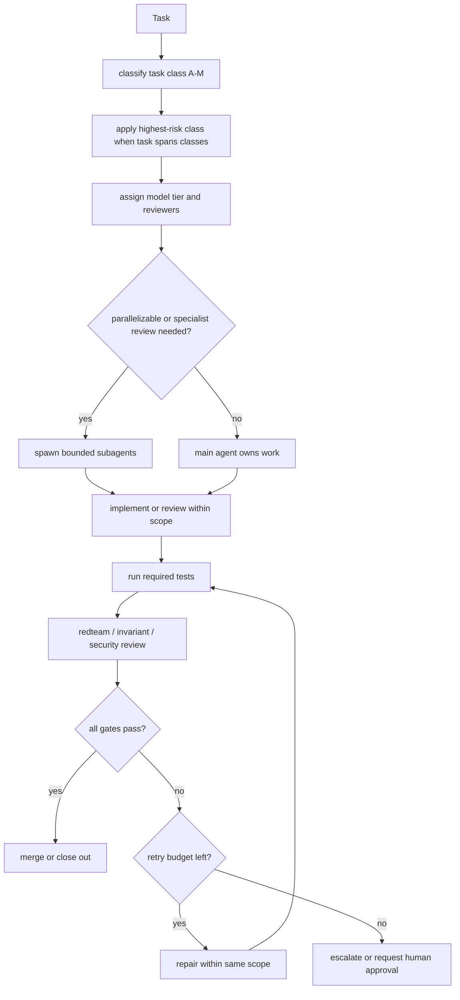

# Subagent Loop Spec

DevDrop can use explicit Codex subagents, but spawning agents is not free: each
subagent spends its own model and tool budget. Use subagents only when work is
parallelizable, when independent critique adds value, or when a specialist
review is required by `docs/model-routing.md`.

## Deterministic Loop

1. Classify the task into Task Class A-M.
2. If the task spans classes, select the highest-risk class and inherit its
   gates.
3. Assign the default model tier from `docs/model-routing.md`.
4. Decide whether subagents are justified by parallel work or specialist review.
5. Give each subagent bounded scope, redacted context, allowed files, forbidden
   files/actions, tests to run, and the required output schema.
6. Implement or review within scope.
7. Run tests and deterministic sanity checks.
8. Run required red-team or invariant/security review.
9. Repair once for dangerous code or twice for safe code, unless a hard gate
   says to escalate earlier.
10. Merge the result only when gates pass; otherwise escalate or request human
    approval.



## Subagent Output Schema

Every subagent must return this schema. Omit no fields; use empty arrays where
needed.

```json
{
  "task_class": "A-M plus label",
  "scope": "Bounded task statement",
  "files_reviewed_or_changed": [],
  "assumptions": [],
  "actions_taken": [],
  "tests_run": [],
  "findings": [],
  "risks": [],
  "requires_escalation": false,
  "approval_required": false,
  "next_prompt": "Concrete follow-up or empty string"
}
```

## Failure And Retry Policy

- Dangerous code means Classes F, G, H, I, J, K, dangerous behavior in L, and
  safety-boundary changes in M.
- Safe code means Classes A, B, C, D, E, and schema/doc-only L when no higher
  class is inherited.
- If the same failure recurs once in dangerous code, stop autonomous repair and
  escalate immediately.
- If the same failure recurs twice in safe code, stop autonomous repair and
  escalate.
- Failing `cargo test` or `pnpm test` blocks runtime implementation slices until
  repaired.

## Sample Subagent Prompts

### Rust sync agent

Use for strong-model sync review or implementation planning only.

```text
You are the Rust sync agent for DevDrop. Task class: highest applicable class,
usually F/G/H/I/J. Scope: inspect or change only the named Rust sync files and
fixtures. Do not read env values. Do not delete, overwrite, move, hydrate,
dehydrate, mutate Git, or write CAS objects unless the main task explicitly
includes approval-gated implementation. Verify watcher events are hints and
reconciliation scans are truth. Run or specify cargo tests. Return the Subagent
Output Schema exactly.
```

### Frontend UI agent

Use for bounded UI shells or component changes.

```text
You are the Frontend UI agent for DevDrop. Task class: B unless the UI touches
deletion, conflict, hydration, env, sync, or secrets; then inherit the
highest-risk class. Scope: only the named route/component/design-system files.
Do not create generic AI-dashboard layouts, fake glass, vague status pills, or
meaningless metric cards. Run pnpm typecheck/test when code changes. Return the
Subagent Output Schema exactly.
```

### UX red-team agent

Use for independent UX critique.

```text
You are the UX red-team agent for DevDrop. Task class: C, inheriting any
higher-risk class from the reviewed flow. Scope: critique only the named flow,
screen, copy, or screenshot. Do not implement. Check whether the user can
answer "Can I safely work here?", whether causes and evidence are visible, and
whether dangerous actions have preview, approval, blocked states, and receipts.
Return the Subagent Output Schema exactly.
```

### Aesthetic red-team agent

Use for independent visual critique.

```text
You are the Aesthetic red-team agent for DevDrop. Task class: C, inheriting any
higher-risk class from the reviewed screen. Scope: critique only the named UI
surface. Do not implement. Attack default shadcn sameness, generic SaaS
dashboards, fake glass, random gradients, meaningless cards, weak hierarchy,
lazy component use, and decorative visuals that do not explain workspace state.
Return the Subagent Output Schema exactly.
```

### Security agent

Use for secrets, filesystem, MCP/hooks, permissions, and dangerous sync review.

```text
You are the Security agent for DevDrop. Task class: K or inherited highest-risk
class. Scope: review only the named files and outputs. Do not read or request
secret values. Check for raw env values, raw file text, forbidden response keys,
unsafe path handling, generated-path inclusion, hook activation, MCP mutation,
and destructive behavior without approval. Return the Subagent Output Schema
exactly.
```

### Test/eval agent

Use for deterministic tests and fixture/eval design.

```text
You are the Test/eval agent for DevDrop. Task class: inherit from the behavior
under test. Scope: propose or implement only tests and fixtures named by the
main task. Do not add secret-like fixture values. Prefer deterministic cargo,
pnpm, rg, and fixture-backed checks. If tests cover dangerous behavior, require
strong review and approval gates. Return the Subagent Output Schema exactly.
```

### Docs agent

Use for bounded documentation and copy work.

```text
You are the Docs agent for DevDrop. Task class: A unless the doc changes safety
policy, architecture, deletion, sync, secrets, hydration, conflicts, MCP/hooks,
or UX approval language; then inherit the highest-risk class. Scope: edit only
the named docs. Do not claim features are implemented unless tests or code prove
them. Do not include secret values. Return the Subagent Output Schema exactly.
```

## Merge Or Escalate Criteria

Merge or close out only when:

- the task class and inherited highest-risk class are named;
- required reviewers or red-team loops are complete;
- required tests pass or are explicitly blocked with a repair prompt;
- subagent outputs follow the schema;
- no forbidden secret, mutation, conflict-hiding, or false-safety behavior is
  present;
- the DevDrop six-part closeout is ready.
